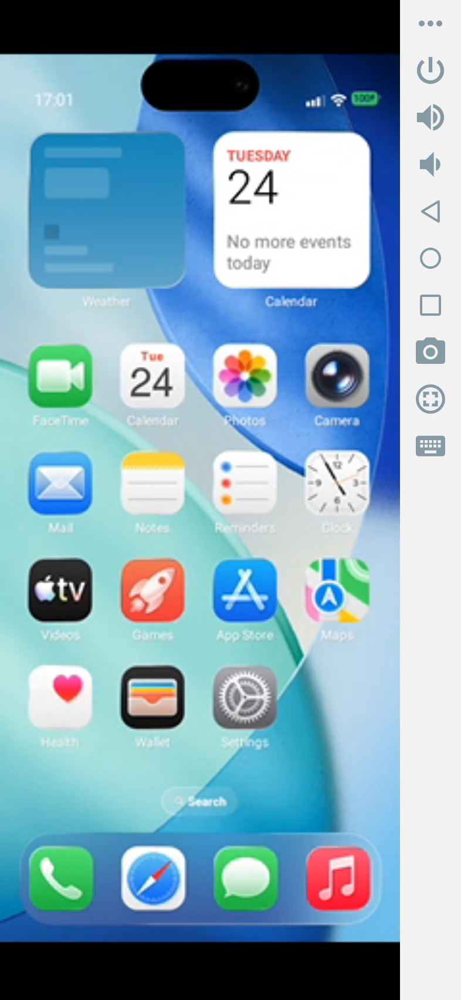
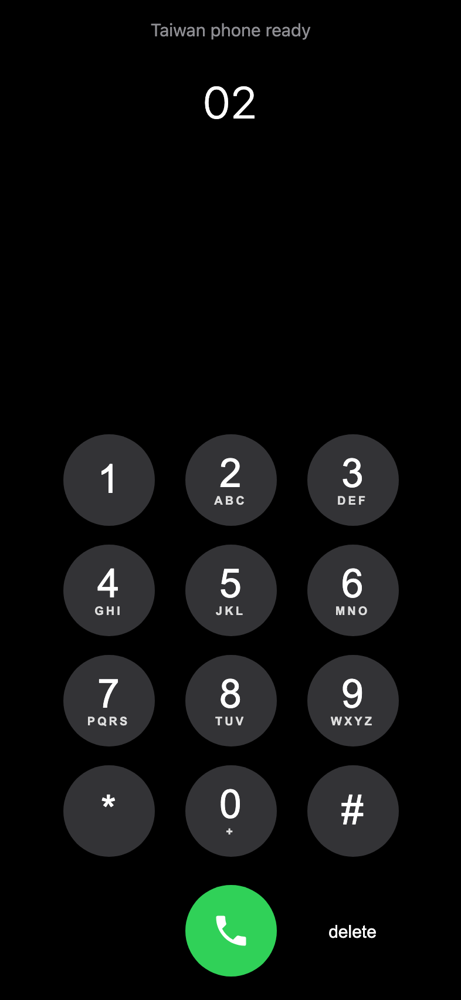
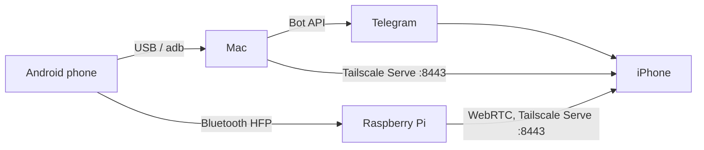

# tw-phone-bridge

Use an Android phone's SIM from an iPhone. The phone stays plugged into a Mac over USB and paired to a Raspberry Pi over Bluetooth.

| Feature | Path |
|---|---|
| Incoming SMS and ring alerts | phone → USB → Mac → Telegram bot |
| SMS replies | Telegram reply → Mac → USB → phone |
| Screen control | iPhone browser ↔ Tailscale ↔ Mac (ws-scrcpy) ↔ USB ↔ phone |
| Voice calls | iPhone browser ↔ WebRTC over Tailscale ↔ Pi ↔ Bluetooth hands-free ↔ phone |

  
  

## Parts

| Dir | Runs on | What it does |
|---|---|---|
| `android/` | phone | Content provider `local.smsbridge`. Only the adb shell can call it: it requires `android.permission.DUMP`, which third-party apps cannot hold. `content://smsbridge/sms?after=ID` returns new inbox messages as base64 JSON. `call send` sends an SMS and waits for the radio's sent result. |
| `mac/` | Mac, launchd `local.smsbridge` | Polls the provider and `dumpsys telephony.registry` every 3 s. Forwards texts and ringing calls to one Telegram chat. A reply to a forwarded message is sent back as SMS to that number. |
| `remote/` | Mac, launchd `local.phoneremote` | [ws-scrcpy](https://github.com/NetrisTV/ws-scrcpy) pinned and patched to listen on 127.0.0.1, plus a home-screen launcher (`app.html`). |
| `call/` | Pi, systemd `twcall` | oFono drives the phone as a Bluetooth car kit. `twcall.py` takes the SCO voice socket (8 kHz 16-bit PCM) and bridges it to the browser with aiortc. The page dials, answers, hangs up and sends DTMF. |

## Setup

1. Phone: enable USB debugging and authorize the Mac.
2. `android/build.sh`: builds the APK without Gradle, installs it, and grants `READ_SMS` and `SEND_SMS`.
3. `mac/.env` holds `TELEGRAM_BOT_TOKEN`, `TELEGRAM_CHAT_ID`, and optionally `CALLS_URL` (added to ring alerts). Then run `mac/install.sh`.
4. `remote/install.sh`
5. Pi: `apt install ofono bluez-tools`, then pair the phone with the Pi (the Pi acts as a hands-free unit) and trust it. Create `/opt/twcall/venv` with `dbus-fast aiortc aiohttp`. Then run `TWCALL_PI=user@pi call/deploy.sh`.
6. On the iPhone, open both `:8443` URLs in Safari → Share → Add to Home Screen.

## Security

- Both web servers bind to 127.0.0.1. Only Tailscale Serve exposes them, so only devices on the tailnet can reach them. They have no other authentication.
- The bot acts only on messages from `TELEGRAM_CHAT_ID`. Replies go only to numbers the bot itself forwarded.
- Text sent through adb is base64-encoded, and numbers are checked against `\+?[0-9]{3,15}`, so neither can inject shell commands.
- ws-scrcpy is built without its shell, devtools and file-listing features. Its server on the phone listens on loopback only.

## Gotchas

- The Pi's Broadcom controller routes SCO audio to its PCM pins by default. `twcall.service` reroutes it over HCI first: `hcitool cmd 0x3f 0x1c 0x01 0x02 0x00 0x01 0x01`.
- oFono hands over the SCO socket with deferred setup, which the first `recv` accepts. Until then the socket is never readable.
- The audio pump writes one uplink packet per downlink packet it reads. The send rate then matches the radio clock and cannot drift.
- Carrier call forwarding (MMI `**21*`) fails on this phone: VoLTE sends it over XCAP and the carrier rejects it.
